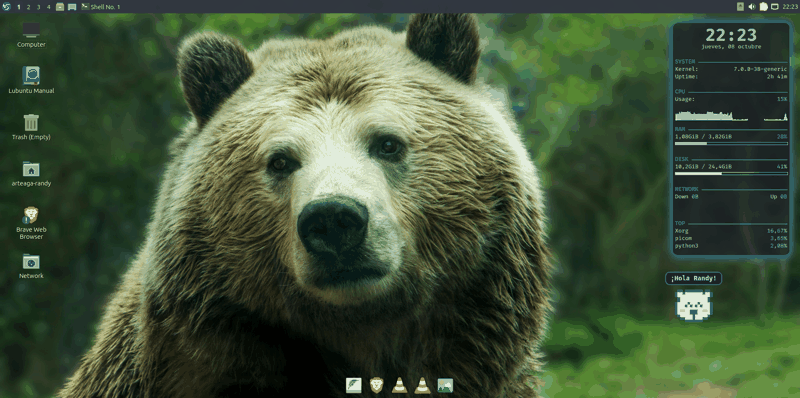

# ʕ•ᴥ•ʔ BearDesk

**BearDesk** is a lightweight pixel-art bear companion that wanders around your Linux X11 desktop, makes 12 different expressions, and drops friendly Linux & developer tips in a Tokyo Night speech bubble.



---

## Español

Un pequeño oso pixel-art con paleta **Tokyo Night** que camina dando saltitos por tu escritorio Linux (X11), cambia entre **12 expresiones** y muestra mensajes motivadores y atajos de terminal en un globo de diálogo.

### Características

- **Camina por tu escritorio** dando pequeños saltos y se detiene para decir algo.
- **12 expresiones pixel-art (matriz 15×13)**: `normal`, `blink`, `happy`, `love`, `surprised`, `wink`, `dizzy`, `sad`, `cool`, `angry`, `silly` y `sleepy`.
- **Mensajes según su estado de ánimo**: tips de Linux (`tldr tar`, `Ctrl+R`, `man > Google`, `chmod +x`) y recordatorios para hacer `git commit`.
- **Ciclo de sueño automático**: duerme entre las `23:00` y las `06:00` (`Durmiendo... zZz`).
- **No estorba al trabajar**: vive en la capa inferior del escritorio, debajo de tus ventanas, y los clics del mouse pasan a través de él (`WindowTransparentForInput`).
- **Ultraligero**: un único archivo en Python (`bear_pet.py`) usando `PyQt6`.

### Requisitos

- Linux con sesión **X11** (probado en Lubuntu / LXQt + Openbox).
- Un compositor como `picom` para el fondo transparente.
- `python3-pyqt6` y `wmctrl` (el script `install.sh` instala ambos automáticamente).

### Instalación

```bash
git clone https://github.com/Steimber/BearDesk.git
cd BearDesk
./install.sh
```

El instalador copia `bear_pet.py` a `~/.local/bin/` y agrega una entrada en `~/.config/autostart/` para que **BearDesk** inicie automáticamente al iniciar sesión.

Para ejecutarlo una sola vez sin instalar:

```bash
python3 bear_pet.py
```

### Desinstalación

```bash
./uninstall.sh
```

---

## English

### Features

- **Walks around** the desktop with a little hop, then stops to say something.
- **12 expressions**: `normal`, `blink`, `happy`, `love`, `surprised`, `wink`, `dizzy`, `sad`, `cool`, `angry`, `silly`, and `sleepy`.
- **Mood-based messages**: each face has its own lines and Linux tips.
- **Goes to sleep** automatically between `23:00` and `06:00`.
- **Stays out of your way**: lives on the desktop layer below your windows, and mouse clicks pass straight through it.
- **Lightweight**: a single Python file (`bear_pet.py`) that only repaints the compact bounding box around the bear and its bubble.

### Install

```bash
git clone https://github.com/Steimber/BearDesk.git
cd BearDesk
./install.sh
```

### Customize

Everything lives in `bear_pet.py`:

| What | Where |
|---|---|
| Add or edit messages | `MSGS` dictionary (one list per face) |
| Draw a new face | `FACES` dictionary: override rows 5–11 of the 15×13 grid |
| Colors | `COLORS` (`X` outline `#3d59a1`, `.` fill `#c0caf5`, `P` pink `#ff79c6`, `B` blue `#7dcfff`) |
| Bear size | `self.px` (pixel size, default `6`) |
| Walking speed | `step = min(d, 2.2)` in `tick()` |

### Using `picom`?

Exclude the window from shadows, focus dimming, and rounded corners so it blends seamlessly with your wallpaper:

```conf
shadow-exclude = [ "name = 'BearPet'" ];
focus-exclude = [ "name = 'BearPet'" ];
rounded-corners-exclude = [ "name = 'BearPet'" ];
```

## License

[MIT](LICENSE)
